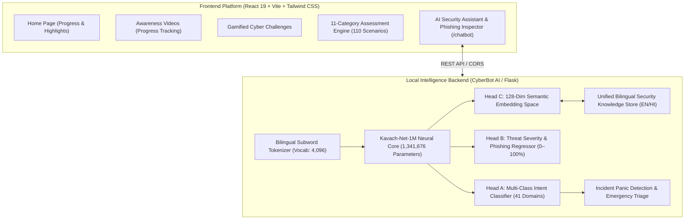

# 🛡️ Kavach: Comprehensive Cybersecurity Awareness Platform

<div align="center">


**An interactive, bilingual, and privacy-preserving cybersecurity training platform powered by a dedicated 1-Million Parameter local AI engine.**

[](https://react.dev/)
[](https://vitejs.dev/)
[](https://tailwindcss.com/)
[](https://pytorch.org/)
[](LICENSE)
[]()
[]()

[Explore Features](#-features) • [Architecture](#-architecture) • [Getting Started](#-quick-start) • [AI Chatbot](#-kavach-net-1m-ai-assistant) • [Contributing](#-contributing)

</div>

---

## 📖 Overview

**Kavach (कवच - *The Digital Armor*)** is an open-source cybersecurity education and threat-prevention platform designed to protect individuals, students, and organizations from modern cyber threats. 

Built around real-world threat vectors—including **UPI scams, OTP fraud, phishing lures, fake websites, social engineering, and ransomware**—Kavach empowers users through bite-sized awareness lessons, scenario challenges, formal domain assessments, and an integrated **100% offline AI Security Assistant**.

---

## 🌟 Key Features

### 1. 🤖 Kavach-Net-1M: Dedicated Local AI Assistant (`/chatbot`)
- **100% Air-Gapped & Private**: Runs entirely on local CPU with zero data leakage, cloud API dependencies, or external tokens.
- **Deep Learning Core**: Powered by **Kavach-Net-1M**, a custom **~1.34 Million Parameter Neural Network** (BiGRU + Multi-Head Scaled Dot-Product Self-Attention).
- **Dual-Mode Workspace**:
  - **💬 AI Security Advisor**: Answers cybersecurity queries, clarifies security concepts, and walks users through immediate step-by-step containment protocols during active emergencies.
  - **🔍 Phishing Message Inspector**: Evaluates suspicious emails, SMS, or URLs with an instant **Risk Assessment Score (0–100%)**, red-flag breakdowns, and actionable verdicts.
- **Typo-Resilient NLP**: Normalizes common misspellings (e.g., `phising`, `ransome`, `malwear`) and matches conceptual intents with high semantic confidence.

### 2. 🌐 Complete Bilingual Support (English & हिन्दी)
- Native bilingual experience across all modules, lessons, questions, and AI chatbot responses.
- Instant, state-preserving language switch in the navigation bar.

### 3. 🎯 11 Core Assessment Domains & 110 Scenarios (`/assessment`)
Test your instincts across 11 critical threat categories:
1. **Phishing**: Spoofed sender domains, urgent invoices, credential harvesting links.
2. **OTP & Banking Fraud**: Remote desktop scams (AnyDesk/TeamViewer), fake KYC calls.
3. **UPI Scams**: Fraudulent collect requests, QR code reverse payment traps.
4. **Passwords & Identity**: Passphrases, breach exposure, password managers, passkeys.
5. **Social Engineering**: Pretexting, baiting, executive spoofing, urgency traps.
6. **Fake Websites**: Lookalike domains, typosquatting, deceptive login portals.
7. **Online Shopping**: Unbelievable discount traps, off-platform payment schemes.
8. **Public Wi-Fi**: Evil Twin hotspots, unencrypted traffic interception, captive portals.
9. **Job Scams**: Upfront registration fee demands, fake offer letters.
10. **QR Code Scams (Quishing)**: Tampered payment stickers, malicious QR redirects.
11. **Social Media Safety**: Impersonation profiles, oversharing, unprompted MFA alerts.

### 4. ⚔️ Practical Cyber Challenges (`/challenges`)
Gamified simulation tracks testing critical decision-making under pressure:
- **Spot the Phishing** (Easy)
- **Beat the Scam** (Medium)
- **Protect Your Account** (Medium)
- **Cyber Expert Challenge** (Hard)

### 5. 🎬 Awareness Video Library (`/awareness`)
12 curated, bite-sized lessons with search, category filtering, and persistent progress tracking via browser `localStorage`.

### 6. 🎨 Modern Dark / Light Mode Experience
Built with a sleek, cyber-themed design language featuring ambient ambient blurs, gradient accents, responsive cards, and full keyboard navigation.

---

## 🏗️ Architecture



---

## 🧠 Kavach-Net-1M AI Assistant

### Model Specifications

| Parameter | Specification |
| :--- | :--- |
| **Model Name** | `Kavach-Net-1M` |
| **Architecture** | 2-Layer Bidirectional GRU + 4-Head Self-Attention + Bottleneck + Multi-Task Heads |
| **Total Parameters** | **1,341,676 (~1.34 Million)** |
| **Weights Footprint** | **5.3 MB** (FP32) |
| **Inference Latency** | **< 15 ms on CPU** (Zero GPU required) |
| **Vocabulary** | 4,096 tokens (Bilingual Subwords for English and Devanagari Hindi) |
| **Training Corpus** | Unified Kavach 11-Domain Curriculum + CyberBot Intents + CTDAPD Network Telemetry |
| **Training Accuracy** | **99.89%** Intent Classification Accuracy |

---

## 📁 Repository Structure

```text
Kavach-Cybersecurity-Platform/
├── public/                 # Static assets, icons, video thumbnails
│   ├── thumbnails/         # Module preview images
│   ├── favicon.svg
│   └── icons.svg
├── src/
│   ├── assets/             # Branding graphics & hero illustration
│   ├── components/         # Shared UI components
│   │   ├── Navbar.jsx      # Navigation, language switch & dark mode toggle
│   │   ├── Footer.jsx      # Platform footer and attribution
│   │   └── VideoCard.jsx   # Video card renderer
│   ├── context/            # React Context providers
│   │   ├── LanguageContext.jsx # Bilingual (en/hi) context state
│   │   └── ThemeContext.jsx    # Dark / Light theme context state
│   ├── data/               # Static datasets and localization
│   │   ├── questions.js    # 110 bilingual assessment questions & explanations
│   │   ├── translations.js # Complete English & Hindi platform strings
│   │   └── videos.js       # Awareness video curriculum database
│   ├── pages/              # Application pages
│   │   ├── Home.jsx        # Landing hero and progress dashboard
│   │   ├── Awareness.jsx   # Video learning library
│   │   ├── Challenges.jsx  # Interactive challenge simulator
│   │   ├── Assessment.jsx  # Category-driven assessment quiz
│   │   └── Chatbot.jsx     # Integrated 1M-parameter AI assistant & phishing inspector
│   ├── App.jsx             # React Router DOM layout
│   ├── main.jsx            # Application entry point
│   └── index.css           # Tailwind CSS v4 styling rules
├── package.json            # Node.js dependencies and scripts
├── vite.config.js          # Vite configuration
└── README.md               # Project documentation
```

---

## 🚀 Quick Start Guide

### Prerequisites
- **Node.js**: v18.0 or later
- **Python**: v3.11 or later (for running the local AI engine)

---

### Step 1: Clone the Repository
```powershell
git clone https://github.com/SalmanKhan123-dev/Kavach-Cybersecurity-Platform.git
cd Kavach-Cybersecurity-Platform
```

### Step 2: Install Frontend Dependencies
```powershell
npm install
```

### Step 3: Start the React Frontend
```powershell
npm run dev
```
Your web browser will open to:
```text
http://localhost:5173
```

---

### Step 4: Run the Local AI Engine (CyberBot Backend)

To enable live AI inference for the `/chatbot` page:

1. Navigate to the `CyberBot-main` directory:
   ```powershell
   cd "../CyberBot-main"
   ```

2. Run the automated test suite to verify the model:
   ```powershell
   py test_backend.py
   ```

3. Launch the local AI server:
   ```powershell
   py app.py
   ```
   *(The AI engine starts on `http://127.0.0.1:5000`)*

4. Return to your browser and click **AI Chatbot** in the navigation bar to start chatting with **Kavach-Net-1M**!

---

## 🛠️ REST API Specification (AI Engine)

| Endpoint | Method | Description |
| :--- | :--- | :--- |
| `/api/chat` | `POST` | Conversational query endpoint with language detection and risk scoring. |
| `/api/analyze/phishing` | `POST` | Inspects arbitrary email/SMS/message text for phishing red flags. |
| `/api/quiz` | `POST/GET`| Interactive quiz state machine supporting English and Hindi. |
| `/api/status` | `GET` | Returns model health, parameter count, and offline capability status. |
| `/api/kavach/assessments` | `GET` | Exposes the 11-category assessment question bank. |

---

## 🤝 Contributing

We welcome contributions to strengthen digital awareness and build stronger defenses!

1. **Fork** the repository.
2. **Create a Feature Branch**:
   ```powershell
   git checkout -b feature/your-feature-name
   ```
3. **Commit your changes**:
   ```powershell
   git commit -m "feat: add new cybersecurity module"
   ```
4. **Push to your branch**:
   ```powershell
   git push origin feature/your-feature-name
   ```
5. Open a **Pull Request** explaining your enhancements.

---

## 👥 Authors & Contributors

- **Salman Khan ([@SalmanKhan123-dev](https://github.com/SalmanKhan123-dev))** — Platform Architect & Core Developer.
- **Farhan ([@farhan4783](https://github.com/farhan4783))** — 1M Parameter Deep Learning Engine (`Kavach-Net-1M`), Phishing Inspector & AI Chatbot Integration.

---

## 📄 License

This project is licensed under the **MIT License** — feel free to use, customize, and deploy it to train safer digital communities.
